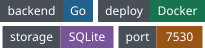

<p align="center"></p>
<h1 align="center">NaviDock</h1>
<p align="center"><em>从内网和外网访问自己的 NAS 服务</em></p>
<p align="center"></p>
<p align="center"><a href="README.md">English</a> | <strong>简体中文</strong></p>

---

部署在 NAS 上的个人导航页，可根据当前网络为同一个服务选择内网或外网地址。

## 快速开始

```sh
cp .env.example .env
docker compose up -d --build
```

打开 http://localhost:7530 。绑定宿主机目录时，在 `.env` 中将 `PUID`、`PGID` 设为目录所有者的 ID，默认均为 1000。

## 首页与设置

首页展示服务图标，可自定义浏览器标签标题、背景图和透明度。顶栏可切换浅色、深色或跟随系统。设置页支持中文和英文，配置保存在 SQLite。

## 自动选择网络地址

在部署环境的 `.env` 或 Compose 的 `environment` 中设置 `LAN_PROBE_DOMAIN`，例如 `lan.zeven.site`。配置分区 DNS，让该域名仅在内网解析到此 NaviDock 实例。使用 HTTPS 时，探测域名也需要有效证书。

浏览器沿用页面协议，请求固定路径 `/api/network/ping`，超时为 1000 毫秒。探测接口公开返回 `204 No Content` 并禁用缓存。自动模式按探测结果选用服务地址，也可手动固定为内网或外网模式。

## 本地开发与构建

在两个终端分别运行 `./scripts/dev-backend.sh` 和 `./scripts/dev-frontend.sh`。Windows 使用对应的 `.ps1` 脚本。Vite 将 `/api` 代理到 `http://127.0.0.1:7530`。

构建时可以设置 `APP_VERSION`，Compose 将其作为 `VERSION` 写入二进制。默认读取仓库中的 `VERSION` 文件。

```powershell
$env:APP_VERSION = "v0.1.0"
docker compose build
```
