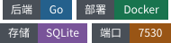

<p align="center"></p>
<h1 align="center">NaviDock</h1>
<p align="center"><em>从内网和外网访问自己的 NAS 服务</em></p>
<p align="center"></p>
<p align="center"><a href="README.md">English</a> | <strong>简体中文</strong></p>


---

部署在 NAS 上的个人导航页，可根据当前网络为同一个服务选择内网或外网地址。

## 目录结构

```
navi-dock/
├── docker-compose.yml
├── Dockerfile
├── .env.example
├── README.md
├── backend/
├── frontend/
├── migrations/
├── configs/
├── scripts/
└── docs/
```

## 快速开始

```bash
cp .env.example .env
docker compose up -d --build
```

绑定宿主机目录时，在 `.env` 中将 `PUID`、`PGID` 设为目录所有者的 ID（用 `id <user>` 查看）。两项默认均为 1000。打开 http://localhost:7530 。

### 指定构建版本

设置 `APP_VERSION` 后，Compose 通过构建参数 `VERSION` 将版本写入二进制文件。默认读取仓库中的 `VERSION` 文件。

PowerShell：

```powershell
$env:APP_VERSION = "v0.1.0"
docker compose build
```

Bash：

```bash
APP_VERSION=v0.1.0 docker compose build
```

## 首页与设置

- 首页展示服务图标。
- 设置页支持中文和英文。
- 自定义浏览器标签页标题。
- 顶栏切换浅色、深色或跟随系统主题。
- 切换网络访问模式。
- 自定义首页背景图及透明度。
- 配置保存在 SQLite。

## 本地开发

在两个终端分别启动后端与前端。

### 后端

```bash
./scripts/dev-backend.sh
# Windows: .\scripts\dev-backend.ps1
```

### 前端

```bash
./scripts/dev-frontend.sh
# Windows: .\scripts\dev-frontend.ps1
```

Vite 将 `/api` 代理到 `http://127.0.0.1:7530`。

## 自动选择网络地址

在部署环境的 `.env` 或 Compose 的 `environment` 中设置探测域名：

```env
LAN_PROBE_DOMAIN=lan.zeven.site
```

域名通过环境变量配置。浏览器沿用页面协议，请求固定路径 `/api/network/ping`，超时为 1000 毫秒。

配置分区 DNS，让探测域名仅在内网解析到此 NaviDock 实例。探测接口公开返回 `204 No Content` 并禁用缓存。使用 HTTPS 时，探测域名也需要有效证书。

- **自动**：保留自动模式，按探测结果选用服务的内网或外网地址。
- **内网 / 外网**：固定使用对应地址。
